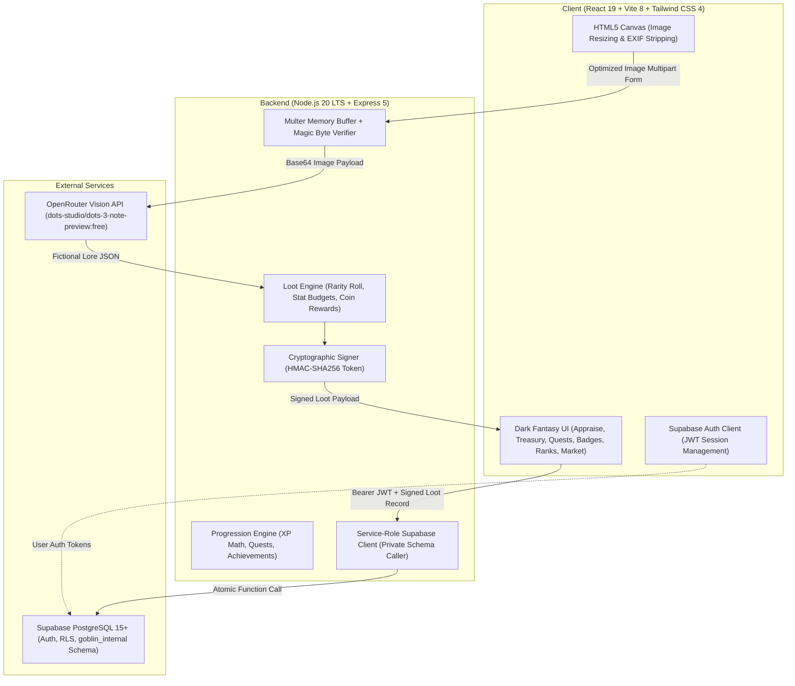

# 👹 LootGoblin

<p align="center">
  <strong>Touch grass. Find loot.</strong><br />
  Turn the ordinary world into an extraordinary RPG adventure.
</p>

<p align="center">
  
  
  
  
  
  
  
  
  
</p>

<p align="center">
  <a href="#-what-is-lootgoblin">What is LootGoblin?</a> ·
  <a href="#-how-it-works">How It Works</a> ·
  <a href="#-key-features">Key Features</a> ·
  <a href="#-the-rarity-economy-system">Rarity & Economy</a> ·
  <a href="#-architecture-tech-stack">Architecture</a> ·
  <a href="#-prerequisites">Prerequisites</a> ·
  <a href="#-quick-start">Quick Start</a> ·
  <a href="#-environment-variables">Environment Variables</a> ·
  <a href="#-database-setup-supabase">Database Setup</a> ·
  <a href="#-running-tests">Running Tests</a> ·
  <a href="#-deployment">Deployment</a> ·
  <a href="#-troubleshooting">Troubleshooting</a> ·
  <a href="#-privacy-security-limitations">Privacy & Security</a> ·
  <a href="#-contributing">Contributing</a> ·
  <a href="#-roadmap">Roadmap</a> ·
  <a href="#-license">License</a>
</p>

---

## 🎒 What is LootGoblin?

What if that fallen oak leaf on your morning walk was actually a **Legendary Nature Relic**?

**LootGoblin** is an outdoor collectible web RPG that transforms everyday physical objects into fantasy game loot. Snap a photo of a pinecone, a curious river pebble, a rusted washer, or an oddly shaped twig. An AI vision model analyzes its physical features and weaves creative fantasy lore, while a server-authoritative game engine rolls rarity, assigns RPG combat stats, and calculates Goblin Coin rewards.

Save items to your persistent Treasury, complete daily outdoor quests, level up your goblin adventurer, unlock achievements, climb the public leaderboards, or swap treasures with other players in the Trading Outpost.

The entire world is your loot table.

> **The Goblin Code:** Real-world exploration, fictional rewards. Take only photos, leave everything where you found it.

---

## 🗺️ How It Works

```text
       PHYSICAL WORLD
             │
             ▼
     📸 1. Capture & Optimize (Browser Camera or File Upload)
             │ Canvas resizes image to <= 1024px max dimension, strips EXIF data
             ▼
     🛡️ 2. Server Validation & Deep Inspection (Node.js & Express)
             │ Inspects file magic bytes (JPEG, PNG, WebP) to prevent spoofing
             │
             ├──▶ AI Vision Appraisal (OpenRouter API)
             │    Generates name, item type, narrative lore, visual notes, ability
             │
             └──▶ Server-Authoritative Game Engine
                  • Rolls deterministic rarity (Common to Legendary)
                  • Allocates bounded stat budgets (ATK, DEF, SPD, INT, LUCK)
                  • Awards rarity-weighted Goblin Coins
                  • Signs full payload with HMAC-SHA256 token
             │
             ▼
     ✨ 3. Loot Card Presentation
             │ Displays animated rarity borders, stats, lore, and coin rewards
             ▼
     🏰 4. Persistent Treasury, Progression & Trading
             • Saves securely using Supabase JWT authentication
             • Verifies cryptographic HMAC signature to prevent stat tampering
             • Runs atomic updates in private PostgreSQL schema (goblin_internal)
             • Updates daily quests, tracks scavenger hunts, and manages peer trades
```

---

## ✨ Key Features

### 🔍 Vision Appraisals & Fantasy Lore
- **AI-Powered Item Appraisal:** Uses an open-weight vision model via OpenRouter's OpenAI-compatible API (`dots-studio/dots-3-note-preview:free`) to examine visual details and spin humorous, immersive RPG lore.
- **Client-Side Image Optimization:** Resizes high-resolution smartphone photos in an in-memory HTML5 Canvas to 1024px before transmission, drastically reducing upload latency and bandwidth.
- **Magic Byte Verification:** Inspects binary headers (`FF D8 FF` for JPEG, `89 50 4E 47` for PNG, `RIFF...WEBP` for WebP) in memory to block invalid or malicious files before calling the AI provider.

### ⚖️ Server-Authoritative Balance & Cryptographic Security
- **Strictly Bounded Stats:** The AI never sets numerical values. Rarity rolls, stat distributions (ATK, DEF, SPD, INT, LUCK), and coin values are computed server-side under strict mathematical caps.
- **Full-Payload HMAC-SHA256 Signing:** Every appraisal is signed with a secret server key. If a user modifies their stats, coin reward, or rarity before saving, the server rejects the write.
- **Private PostgreSQL Schema:** Critical database write functions run inside a private schema (`goblin_internal`) accessible only to the server's service role, blocking direct client manipulation.

### 💰 Treasury & Progression
- **Persistent Personal Treasury:** Authenticated players save appraised relics to their personal inventory, filter by rarity, sort by date or value, and view hoarded item cards.
- **Deterministic XP & Level Curve:** Earn XP from appraising relics, completing quests, and unlocking achievements. Level scaling follows a smooth exponential curve:
  $$\text{XP Required for Level } L = 100 \times (L - 1)^{1.5}$$
- **Rotating Daily Quests:** Three deterministic quests generated daily based on UTC calendar dates (e.g. appraising specific rarities, finding nature relics).
- **Themed Scavenger Hunts:** Multi-stage outdoor hunting goals (e.g. Forest Curios, Ancient Minerals) with bonus XP and coin rewards.
- **Badges & Achievements:** 10 collectible milestones tracking inventory size, rare discoveries, and completed quests.

### 🤝 Trading Outpost & Leaderboards
- **Peer-to-Peer Trading:** Post open trade offers with custom wanted descriptions, browse active market stalls, and exchange items safely.
- **Deadlock-Free Atomic Swaps:** Stored procedures acquire PostgreSQL row-level locks in deterministic alphabetical order, preventing race conditions and double-trading.
- **Opt-in Public Profiles:** Privacy by default. User profiles remain hidden from leaderboards until the player explicitly opts in and chooses a public goblin display name.
- **Hall of Fame Leaderboards:** Browse top players ranked by level, total relics hoarded, and unlocked achievements through a secure database view that never exposes email addresses or private inventory records.

### 📱 User Experience & Resilience
- **Dark Fantasy Aesthetic:** Atmospheric palette with moss green, stone-gray, weathered parchment, and custom rarity glow effects.
- **Offline & Model Fallback:** If the AI provider times out or experiences an outage, the app falls back to themed offline loot cards (`source: "fallback"`), ensuring uninterrupted gameplay.
- **Zero-Config Guest Mode:** You can test appraisals and explore the interface immediately without configuring a database.

---

## 🎲 The Rarity & Economy System

Every appraisal triggers a weighted random roll on the server:

| Rarity | Drop Rate | Total Stat Budget | Coin Reward Range | Theme Accent |
| :--- | :---: | :---: | :---: | :--- |
| **Common** | 45% | 4 - 7 pts | 5 - 15 🪙 | Muted Slate Gray |
| **Uncommon** | 28% | 8 - 12 pts | 16 - 40 🪙 | Forest Green |
| **Rare** | 16% | 13 - 18 pts | 41 - 100 🪙 | Arcane Sapphire |
| **Epic** | 8% | 19 - 25 pts | 101 - 250 🪙 | Mystic Purple |
| **Legendary** | 3% | 26 - 35 pts | 251 - 500 🪙 | Radiant Amber Gold |

Stat points are dynamically distributed across five core attributes:
- **ATK (Attack):** Offensive potential and cutting edge.
- **DEF (Defense):** Durability, hardness, and resilience.
- **SPD (Speed):** Aerodynamics, weight, and swiftness.
- **INT (Intelligence):** Arcane resonance and ancient wisdom.
- **LUCK (Luck):** Odd fortune and bizarre quirks.

---

## 🛠️ Architecture & Tech Stack



### Component Breakdown
- **Frontend:** React 19, Vite 8, Tailwind CSS 4, Lucide Icons.
- **Backend:** Node.js 20 LTS, Express 5, Multer (in-memory file handling), Zod (runtime validation), Express Rate Limit.
- **AI Vision:** OpenRouter OpenAI-compatible API using the free vision model `dots-studio/dots-3-note-preview:free`.
- **Database & Authentication:** Supabase (PostgreSQL 15+, GoTrue Auth, Row Level Security, private schema functions).
- **Deployment:** Render Web Service (unified production build serving both the Express API and static React frontend).

---

## 📋 Prerequisites

Before setting up LootGoblin locally, ensure you have:
1. **Node.js 20 LTS** or higher ([nodejs.org](https://nodejs.org))
2. **npm 10** or higher
3. An **OpenRouter API Key** ([openrouter.ai](https://openrouter.ai)) with access to free vision models
4. A free **Supabase Account** ([supabase.com](https://supabase.com)) if you wish to test user accounts, persistent inventory, leaderboards, and trading

> [!NOTE]
> If you only want to test item appraisals without persistent accounts, you do not need Supabase. The app starts and runs gracefully in guest appraisal mode.

---

## ⚡ Quick Start

### 1. Clone the Repository
```bash
git clone https://github.com/Gauthamkv14/irl-loot-goblin.git
cd irl-loot-goblin
```

### 2. Install Dependencies
Install dependencies for both the frontend and backend:
```bash
npm --prefix client install
npm --prefix server install
```

### 3. Set Up Environment Files
Copy the template files into active environment configurations:

**On Windows (PowerShell):**
```powershell
Copy-Item server/.env.example server/.env
Copy-Item client/.env.example client/.env
```

**On macOS / Linux (Bash):**
```bash
cp server/.env.example server/.env
cp client/.env.example client/.env
```

Edit `server/.env` to include your OpenRouter API key. See [Environment Variables](#-environment-variables) for full details.

### 4. Run the Application

You can run LootGoblin in either development mode or unified production mode:

#### Option A: Local Development Mode (Recommended for Development)
Start the backend API in your first terminal window:
```bash
npm run server:dev
```
*(Runs Express with automatic reload on `http://localhost:3000`)*

Start the frontend Vite server in a second terminal window:
```bash
npm run client:dev
```
*(Runs Vite with hot module replacement on `http://localhost:5173`, automatically proxying `/api` calls to port 3000)*

Open [http://localhost:5173](http://localhost:5173) in your browser.

#### Option B: Unified Production Mode (Recommended for Verification)
Build the frontend assets and run the unified Express production server:
```bash
npm run build
npm start
```
Open [http://localhost:3000](http://localhost:3000) in your browser.

---

## 🔑 Environment Variables

The project strictly separates server-side secrets from public client variables.

### Backend Secrets (`server/.env`)
These variables must **never** be shared or committed to source control:

| Variable | Required | Default / Example | Purpose |
| :--- | :---: | :--- | :--- |
| `PROVIDER_BASE_URL` | Yes | `https://openrouter.ai/api/v1` | OpenRouter OpenAI-compatible endpoint |
| `PROVIDER_API_KEY` | Yes | `sk-or-v1-...` | Your private OpenRouter API key |
| `MODEL_ID` | Yes | `dots-studio/dots-3-note-preview:free` | AI vision model identifier |
| `PORT` | No | `3000` | Port for the Express server |
| `LOOT_SIGNING_SECRET` | **Prod Only** | 64-character hex string | HMAC secret for tamper-proofing appraisals |
| `SUPABASE_URL` | For Auth | `https://xyzproject.supabase.co` | Supabase project REST URL |
| `SUPABASE_ANON_KEY` | For Auth | `eyJhbGci...` | Supabase public key for server token verification |
| `SUPABASE_SERVICE_ROLE_KEY` | For Auth | `eyJhbGci...` | Supabase service-role key for internal stored procedures |

#### Generating a Strong Loot Signing Secret
To generate a secure 64-character hex string for `LOOT_SIGNING_SECRET`:
```bash
node -e "console.log(require('crypto').randomBytes(32).toString('hex'))"
```

### Frontend Configuration (`client/.env`)
These variables are bundled into static JavaScript by Vite and are visible in browser requests:

| Variable | Required | Default / Example | Purpose |
| :--- | :---: | :--- | :--- |
| `VITE_SUPABASE_URL` | For Auth | `https://xyzproject.supabase.co` | Supabase project URL for client authentication |
| `VITE_SUPABASE_PUBLISHABLE_KEY` | For Auth | `eyJhbGci...` | Supabase anonymous/publishable key for browser client |

> [!CAUTION]
> Never place `PROVIDER_API_KEY`, `LOOT_SIGNING_SECRET`, or `SUPABASE_SERVICE_ROLE_KEY` into `client/.env` or prefix them with `VITE_`. Doing so exposes your server credentials to anyone visiting the site.

---

## 🗄️ Database Setup (Supabase)

To enable user accounts, inventory persistence, daily quests, leaderboards, and item trading, connect a Supabase project:

### 1. Create a Supabase Project
1. Sign in to [supabase.com](https://supabase.com) and create a new project.
2. Under **Project Settings -> API**, copy:
   - **Project URL** into `SUPABASE_URL` (`server/.env`) and `VITE_SUPABASE_URL` (`client/.env`).
   - **anon / public key** into `SUPABASE_ANON_KEY` (`server/.env`) and `VITE_SUPABASE_PUBLISHABLE_KEY` (`client/.env`).
   - **service_role key** into `SUPABASE_SERVICE_ROLE_KEY` (`server/.env`).

### 2. Configure Exposed Schemas
In the Supabase Dashboard, navigate to **Project Settings -> API -> Extra search path / Exposed schemas**. Add `goblin_internal` alongside `public` and save changes.

*(Exposing this schema in PostgREST allows the backend's service-role client to call internal stored procedures. Because permissions on `goblin_internal` are revoked from anonymous and authenticated roles, end users cannot call these functions directly).*

### 3. Run Database Migrations
Open the Supabase **SQL Editor -> New query** and run the migration files in numerical order:

```text
supabase/migrations/
├── 20261010000000_initial_schema.sql
├── 20261011000000_phase6_progression.sql
├── 20261011010000_progression_security_remediation.sql
├── 20261011020000_private_rpc_security_remediation.sql
├── 20261011030000_phase7_leaderboards_and_trading.sql
├── 20261011040000_fix_trade_offers_permissions.sql
└── 20261011050000_fix_loot_items_permissions.sql
```

#### Migration Details:
1. `20261010000000_initial_schema.sql`: Sets up user profiles, the `loot_items` table, initial Row Level Security (RLS) policies, and automatic profile creation triggers.
2. `20261011000000_phase6_progression.sql`: Adds tables for player progression, daily quests, scavenger hunts, and achievements.
3. `20261011010000_progression_security_remediation.sql`: Revokes direct client `INSERT`, `UPDATE`, and `DELETE` permissions on progression tables to prevent stat tampering.
4. `20261011020000_private_rpc_security_remediation.sql`: Creates the isolated `goblin_internal` schema and the atomic `hoard_relic_atomic` stored procedure.
5. `20261011030000_phase7_leaderboards_and_trading.sql`: Adds public profile fields, the privacy-preserving leaderboard view, trading tables, and atomic swap procedures.
6. `20261011040000_fix_trade_offers_permissions.sql`: Grants necessary read permissions on open trade offers and ensures the service role can manage market state.
7. `20261011050000_fix_loot_items_permissions.sql`: Grants SELECT permissions on `loot_items` to `authenticated` under RLS and ensures direct client mutation privileges remain revoked.

> [!TIP]
> If you are upgrading an existing database that already ran `20261010000000_initial_schema.sql`, skip that first file and run files 2 through 7 in order to prevent duplicate policy errors.

### 4. Configure Authentication URLs
In **Authentication -> URL Configuration**:
- **Site URL:**
  - Local dev: `http://localhost:5173` (or `http://localhost:3000` for production builds)
  - Production: `https://loot-goblin.onrender.com`
- **Redirect URLs:** Add both local and production callback patterns:
  - `http://localhost:5173/**`
  - `http://localhost:3000/**`
  - `https://loot-goblin.onrender.com/**`

---

## 🧪 Running Tests

LootGoblin includes comprehensive test suites verifying mathematical balance, API contracts, cryptographic security, and database migrations:

```bash
# Run backend unit and live API integration tests
npm run test:server

# Run unit tests only (rarity budgets, stat caps, Zod schemas, safety filters)
npm --prefix server run test:unit

# Run live API integration tests (image magic byte verification, vision model appraisal)
npm --prefix server run test:api

# Run cryptographic integrity and tamper defense tests
node server/test-security.js

# Run progression curve math, daily quest rotation, and achievement tests
node server/test-progression.js

# Run peer-to-peer trading lock ordering, atomic swaps, and leaderboard privacy tests
node server/test-trading-and-leaderboards.js

# Run Supabase SQL migration contract and permission checks
node server/test-supabase-schema.js

# Run frontend/backend API shape contract tests
node server/test-contract.js

# Verify single-service production static serving and SPA routing
node server/test-production-serve.js

# Run full client and server production build check
npm run build
```

---

## 🌐 Deployment

LootGoblin is designed to run as a single unified Node.js Web Service on platforms like [Render](https://render.com). The Express server serves both the JSON API and the compiled React single-page application.

### Render Web Service Configuration
- **Service Type:** Web Service
- **Runtime:** Node
- **Build Command:** `npm run build`
- **Start Command:** `npm start`
- **Health Check Path:** `/api/health`

### Environment Variables on Render
Set the following variables in the Render dashboard:
```text
NODE_VERSION=20
PROVIDER_BASE_URL=https://openrouter.ai/api/v1
PROVIDER_API_KEY=<your_openrouter_api_key>
MODEL_ID=dots-studio/dots-3-note-preview:free
LOOT_SIGNING_SECRET=<your_64_character_hex_secret>
SUPABASE_URL=https://<your_project>.supabase.co
SUPABASE_ANON_KEY=<your_supabase_anon_key>
SUPABASE_SERVICE_ROLE_KEY=<your_supabase_service_role_key>
VITE_SUPABASE_URL=https://<your_project>.supabase.co
VITE_SUPABASE_PUBLISHABLE_KEY=<your_supabase_anon_key>
```

> [!IMPORTANT]
> Keep `LOOT_SIGNING_SECRET` persistent across deployments. If the secret changes during a redeployment, cards appraised prior to the update will fail signature validation upon saving.

For more details on deployment configurations, consult [DEPLOYMENT.md](DEPLOYMENT.md).

---

## 🔧 Troubleshooting

### 1. "Authentication is currently disabled / Supabase Not Configured"
- **Cause:** `VITE_SUPABASE_URL` or `VITE_SUPABASE_PUBLISHABLE_KEY` is missing or contains placeholder values.
- **Fix:** Add your Supabase project credentials to `client/.env` and restart the Vite development server.

### 2. "FATAL: LOOT_SIGNING_SECRET must be configured in environment variables for production"
- **Cause:** Running in production mode (`NODE_ENV=production`) without a valid `LOOT_SIGNING_SECRET` of at least 32 characters.
- **Fix:** Generate a 64-character hex secret (`node -e "console.log(require('crypto').randomBytes(32).toString('hex'))"`) and add it to your server environment.

### 3. "Tampering detected! Loot record does not match certified server appraisal"
- **Cause:** A loot card attribute was modified before saving, or the server was restarted with a newly randomized signing secret between appraisal and save.
- **Fix:** Ensure `LOOT_SIGNING_SECRET` remains constant across server restarts. Do not modify loot card properties before saving.

### 4. "Failed to fetch trade offers: permission denied for table trade_offers"
- **Cause:** Migration `20261011040000_fix_trade_offers_permissions.sql` has not been applied to grant read permissions on trade offers.
- **Fix:** Run `supabase/migrations/20261011040000_fix_trade_offers_permissions.sql` in your Supabase SQL Editor.

### 5. "Corrupted or spoofed image file"
- **Cause:** Uploaded file headers do not match standard JPEG, PNG, or WebP binary magic bytes.
- **Fix:** Ensure you are uploading a genuine image directly from a phone camera or valid image file.

---

## 🛡️ Privacy, Security & Limitations

- **No Geolocation Collected or Stored:** LootGoblin does not access GPS hardware or store coordinates. Photos are stripped of EXIF metadata in the browser's HTML5 Canvas prior to upload.
- **In-Memory Photo Processing:** Uploaded images exist only in server memory for the duration of the AI appraisal call. Full-resolution photos are never stored on disk or in the database.
- **Lightweight Thumbnails:** When a relic is saved to a treasury, only a compressed data URL thumbnail (<= 100 KB) is stored to enable inventory rendering.
- **Model Hallucinations Notice:** Appraisals are whimsical fantasy narratives generated by an artificial intelligence model. They are intended solely for fictional entertainment and do not represent accurate botanical, geological, or monetary evaluations of real-world objects.

---

## 🤝 Contributing

Contributions to LootGoblin are welcome! Whether you are fixing a bug, improving documentation, or proposing new gameplay mechanics, here is how to get started:

1. **Fork the Repository:** Click the "Fork" button at the top of the repository page.
2. **Clone your Fork:**
   ```bash
   git clone https://github.com/<your-username>/irl-loot-goblin.git
   cd irl-loot-goblin
   ```
3. **Create a Feature Branch:**
   ```bash
   git checkout -b feature/amazing-idea
   ```
4. **Make Changes & Test:** Ensure all existing test suites pass:
   ```bash
   npm run test:server
   node server/test-security.js
   node server/test-progression.js
   node server/test-trading-and-leaderboards.js
   npm run build
   ```
5. **Commit with Clear Messages:** Follow conventional commit guidelines where possible.
6. **Open a Pull Request:** Submit your PR against the `main` branch with a clear description of your changes.

---

## 🛣️ Roadmap

- [x] Phase 1: Open-weight vision provider integration smoke test
- [x] Phase 2: Loot generation engine, rarity budgets, and Express API
- [x] Phase 3: Mobile-first dark fantasy UI, Canvas image resizer, and loot cards
- [x] Phase 4: Single-service production serving and Render deployment preparation
- [x] Phase 5: Supabase authentication, server-authoritative loot signing, and persistent treasury
- [x] Phase 6: Daily exploration quests, scavenger hunts, progression math, and security remediation
- [x] Phase 7: Public hoarder leaderboards, opt-in privacy, and trading outpost

---

## 📄 License

This project is licensed under the terms of the MIT License. See [LICENSE.md](LICENSE.md) for full license details.

---

<p align="center">
  <strong>Go outside. Find something weird. Let the Goblin judge it.</strong><br />
  <em>Touch grass. Find loot. 👹</em>
</p>

<p align="center">
  <sub>Made with 💚 by GKV</sub>
</p>